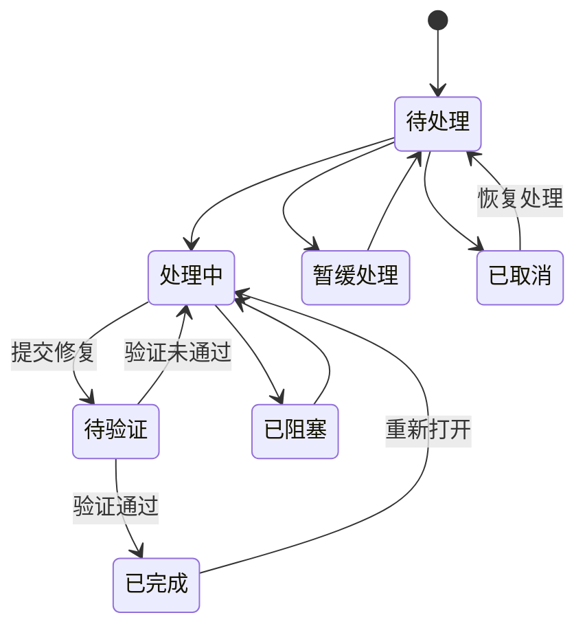

# NoahNote BUG 任务列表设计

日期：2026-10-16

交付范围：产品交互、业务规则、数据设计和开发验收清单。

状态：完整设计草案，尚未实施功能代码。

## 1. 目标与方案选择

增加「BUG 任务」工作台，让用户能够粘贴多行文本批量建单，跟踪处理和验证过程，维护备注及日期，并导出可阅读、可交接的 Markdown 清单。核心操作离线可用，沿用 NoahNote 的个人 / 工作空间和本地文件存储。

| 方案 | 优点 | 代价 | 建议 |
| --- | --- | --- | --- |
| 独立 BUG 实体与页面，复用通用基础设施 | 字段与状态完整，普通任务逻辑清晰，后续方便做回归和统计 | 需要增加存储、索引和页面接入 | 推荐 |
| 在普通任务中增加 BUG 类型与扩展字段 | 初期可复用更多任务页面 | BUG 状态会影响普通任务、项目进度、今日和模板逻辑，长期维护较复杂 | 普通任务与 BUG 生命周期一致时适用 |
| 使用 Markdown 笔记模板 | 记录方便 | 日期校验、状态统计、批量修改依赖人工维护 | 可作为导出格式 |

推荐采用第一种方案。先以项目、版本、模块和标签组织 BUG；首期提供一个统一列表页，多份清单通过筛选与导出标题表达。独立命名清单、列表权限和跨列表移动可在确有需求时增加。

## 2. 功能范围

### 2.1 首期完整闭环

- 新建、编辑、复制、归档、删除和从回收站恢复 BUG。
- 粘贴多行文本导入；支持选择 UTF-8 的 `.txt` / `.md` 文件作为文本来源。
- 导入预览、统一默认值、逐条调整、重复提示、部分失败反馈与重试。
- 七种固定状态；支持快捷完成、验证退回和重新打开。
- BUG 日期、截止日期、完成日期，以及自动创建 / 修改时间。
- Markdown 描述与备注、按时间追加的处理记录。
- 项目、模块、版本、标签、负责人、优先级、严重程度、关注标记。
- 搜索、属性筛选、日期范围、排序、分页、多选和批量操作。
- Markdown 简洁表格 / 完整报告导出、预览、复制和保存。
- 接入现有空间、项目详情、今日、全局搜索、归档、回收站及备份恢复。

### 2.2 后续增强

| 增强项 | 价值 |
| --- | --- |
| 按状态分列的看板与拖动 | 更直观地查看处理流转，复用相同状态规则 |
| 截图、日志与附件 | 复用附件入库，补充预览、空间迁移及恢复规则 |
| 自定义保存视图和列显示偏好 | 快速进入特定版本、模块或负责人的清单 |
| Markdown 结构化回导、CSV / JSON 交换 | 满足保留属性的迁移需求 |
| 回归批次、受影响版本 / 修复版本 | 支持持续发布和多版本跟踪 |
| 跟进日期、应用内提醒 | 支持阻塞和暂缓 BUG 的定期回看 |
| 自定义状态、字段和模板 | 在固定流程稳定后提供扩展 |

负责人和报告人为本地文本字段；多人账号、通知服务和权限体系属于后续独立需求。

## 3. 页面与主要交互

### 3.1 入口与布局

左侧导航在「任务」附近增加「BUG 任务」。默认继承当前空间；新增时必须写入个人或工作空间。在「全部」空间新建或导入时，表单明确显示实际目标空间，默认取应用设置。

```text
BUG 任务                    [导入文本] [导出 Markdown] [+ 新建 BUG]

[全部 48] [待处理 12] [处理中 8] [待验证 6] [逾期 4] [已完成 18]

[搜索编号、标题、描述或备注……]
[状态] [优先级] [严重程度] [项目] [模块/版本] [负责人] [日期] [重置]

[全部] [未完成] [今日截止] [已逾期] [待验证] [已完成] [我关注的]

□ 编号 / 标题       状态      优先级   BUG 日期    截止日期    完成日期
□ BUG-… 登录失败    处理中    P1      10-15       10-18      —
□ BUG-… 按钮错位    已完成    P2      10-14       10-20      10-16

已选 2 项：[改状态] [改优先级] [改截止日期] [导出] [更多]

[当前筛选 26 条]                                      [上一页] [下一页]
```

- 点击标题打开右侧详情；点击状态或日期可快速编辑，点击复选框用于多选。
- 列表默认展示编号 / 标题、状态、优先级及三个业务日期；备注显示摘要，完整内容在详情中查看。项目、模块、负责人等作为可选列，控制列表宽度。
- 默认每页 100 条。全选按钮默认只选当前页，另提供明确的「选中全部筛选结果，共 N 条」。
- 筛选导致条目离开当前结果集时移除其选择；切换空间、项目或进入归档时清空选择。批量操作前显示实际处理数量。
- 详情显示编号、属性、描述、备注、处理记录、创建 / 更新时间和操作区。状态改变后如果条目不再满足筛选，提示「已更新，此 BUG 已移出当前筛选」。

### 3.2 表单与保存

新建和详情编辑采用明确的「保存 / 取消」。状态、优先级和日期的快捷修改单独提交，并显示进行中、成功和失败状态。

描述提供可选模板：问题现象、复现步骤、预期结果、实际结果和环境信息。仅标题必填即可快速记录；描述、环境和负责人可随后补充。

存在未保存输入时，关闭详情、切换条目或切换页面提供「保存并离开 / 放弃修改 / 继续编辑」。保存失败保留全部输入。编辑表单时将快捷状态操作纳入同一份草稿，避免两次写入互相覆盖。

### 3.3 适配和反馈

- 复用 `PageHeader`、`Button`、字段、`DialogLayer`、`EmptyState`、反馈组件和现有语义 Token。
- 大窗口使用列表加详情；空间不足时详情改为抽屉或独立弹框；窄窗口使用卡片摘要与展开属性。
- 筛选项可以收进「更多筛选」；弹框内容内部滚动，标题和底部操作保持可见。
- 状态使用文字加颜色，逾期使用明确的文字标记；完整支持键盘、焦点返回和深浅主题。
- 首次空列表提供「新建 / 导入」；筛选为空提供「清空筛选」。两种空状态分别呈现。

## 4. 字段定义

| 字段 | 用途 | 默认值 / 约束 |
| --- | --- | --- |
| 内部 ID `id` | 文件、关联和索引的稳定标识 | UUID，创建后不变 |
| 编号 `code` | 展示、检索和导出定位 | `BUG-` 加 UUID 前 12 位；发生冲突时延长后缀并持久化 |
| 标题 `title` | 一句话描述问题 | 必填，去除首尾空白，1–300 个 Unicode 字符 |
| 状态 `status` | 处理阶段 | 默认待处理 |
| 优先级 `priority` | 处理顺序 | P0 紧急、P1 高、P2 普通、P3 低；默认 P2 |
| 严重程度 `severity` | 问题影响 | S0 致命、S1 严重、S2 一般、S3 轻微；默认 S2 |
| BUG 日期 `bugDate` | 用户确认的发现日期 | 必填，默认设备本地今天，可补录历史日期 |
| 截止日期 `dueDate` | 计划完成日期 | 可空；没有截止日期时显示「未设置」 |
| 完成日期 `completedDate` | 本轮确认完成日期 | 已完成时必填，其他状态为空 |
| 描述 `description` | 现象、复现步骤、预期与实际结果 | Markdown，可空，最多 100,000 个字符 |
| 备注 `notes` | 当前处理摘要和补充说明 | Markdown，可空，最多 20,000 个字符 |
| 处理记录 `activities` | 追加说明和变更轨迹 | 自动生成事件；用户可追加记录，每条说明最多 10,000 个字符 |
| 环境 `environment` | 系统、设备、构建版本等 | 可空，最多 2,000 个字符 |
| 项目 `projectId` | 关联现有项目 | 可空，只能关联同一空间的项目 |
| 模块 `module` | 登录、编辑器、同步等分类 | 可空，文本，最多 100 个字符 |
| 版本 `version` | 本次发现问题的版本 | 可空，文本，最多 100 个字符 |
| 负责人 `assignee` | 记录跟进人 | 可空，文本，最多 100 个字符 |
| 报告人 `reporter` | 记录发现人 | 可空，文本，最多 100 个字符 |
| 标签 `tags` | 多维分类 | 复用现有标签规范 |
| 取消信息 `resolution` | 重复、非 BUG 等结论 | 取消时必填，其余状态为空 |
| 重新打开次数 `reopenCount` | 辅助判断回归问题 | 初始为 0；从已完成重新打开时增加 |
| 关注 / 归档 `favorite` / `archived` | 个人关注与收纳 | 默认 false |
| 来源 `source` | 手动、复制、文本导入及导入幂等标识 | 系统维护 |
| 创建 / 修改时间 | 记录进入系统和最后修改的时刻 | 系统 UTC 时间戳，界面按本地时区显示 |
| 同步元数据 | 与现有实体保持一致 | `deviceId`、`workspaceId`、`revision` |

备注用于维护当前结论，处理记录用于保留过程。修改备注会留下变更事件；追加的处理记录按时间排列，首期通过追加更正说明处理错误记录。

优先级与严重程度独立。例如影响极小但发布前必须修复的问题可以是 P1 / S3。筛选和导出分别表达这两个字段。

## 5. 状态流转

### 5.1 状态集合

| 状态 | 内部值 | 含义 |
| --- | --- | --- |
| 待处理 | `todo` | 已记录，等待处理 |
| 处理中 | `in_progress` | 正在定位或修复 |
| 已阻塞 | `blocked` | 因依赖或条件不足无法推进 |
| 待验证 | `pending_verification` | 已修复，等待确认结果 |
| 暂缓处理 | `deferred` | 已决定延后处理 |
| 已完成 | `done` | 已确认修复完成 |
| 已取消 | `cancelled` | 重复、非 BUG、不修复等明确结论 |



图示为常用路径。待处理、处理中、已阻塞、待验证、暂缓处理这五种未完成状态之间允许直接切换；也可以直接完成或取消，以支持快速记录和历史补录。

### 5.2 操作规则

- 标记完成：自动预填今天为完成日期，允许修改。直接完成时明确表达「确认问题已修复」，无需强制经过待验证。
- 待验证：继续计入未完成；完成日期保持为空。验证未通过返回处理中，要求填写验证说明。
- 已阻塞 / 暂缓处理：要求填写原因并追加处理记录；原截止日期继续生效。
- 已完成重新打开：通过专门操作进入处理中，要求说明原因，清空当前完成日期，次数加一。历史完成日期保留在事件中。
- 已取消恢复处理：通过专门操作进入待处理，清空取消信息，保留历史结论；重新打开次数保持原值。
- 已完成与已取消之间的转换先执行重新打开或恢复处理，再提交新的结论，避免无说明覆盖结束原因。
- 取消原因支持重复问题、非 BUG、无法复现、暂不修复、其他。选择「其他」必须补充说明。
- 重复问题必须关联同空间另一条 BUG，禁止关联自身和形成循环；同时记录目标编号与标题快照，目标删除后仍能读懂历史原因。
- 重复提交相同状态属于无状态变更；不增加重复状态事件。其他字段变化仍正常保存。

前端入口、批量修改、导入与后端 API 使用相同业务规则，无法通过不同入口跳过日期或原因校验。

## 6. 日期、逾期与统计

### 6.1 日期规则

三个业务日期均保存为有效的 `YYYY-MM-DD` 日历日期。创建、修改和事件时间保存为带时区的 UTC 时间戳。日期控件与比较逻辑直接使用日历日期，避免将日期转换为 UTC 后出现前后错一天。

| 场景 | 规则 |
| --- | --- |
| BUG 日期 | 必填，不得晚于本地今天 |
| 截止日期 | 可空；设置时不得早于 BUG 日期，可选择过去日期以补录逾期任务 |
| 完成日期 | 已完成时必填，且 BUG 日期 ≤ 完成日期 ≤ 本地今天 |
| 完成晚于截止 | 合法，显示「延期完成 N 天」 |
| 编辑已完成 BUG | 校验修改后的三个日期整体一致，普通属性修改保留原完成日期 |
| 从已完成重新打开 | 当前完成日期清空，事件保留原日期；截止日期保留，可另行调整 |
| 取消、归档 | 不生成完成日期；归档保持原状态与日期 |

服务端以设备本地日期进行最终校验；前端展示相同规则。跨午夜、应用从后台恢复以及设备时区变化后，重新计算今天、逾期和筛选结果。

### 6.2 计算口径

- 未完成：状态属于待处理、处理中、已阻塞、待验证、暂缓处理。
- 逾期：未完成，并且存在截止日期且截止日期早于今天。
- 今日截止：未完成，并且截止日期等于今天。
- 已完成和已取消不出现在当前逾期 / 今日截止中；已完成条目仍可显示历史延期天数。
- 完成率 = 已完成数 ÷（总数 − 已取消数）；分母为 0 时显示 `—`。
- 阻塞或暂缓不会自动暂停截止日期；需要延后时由用户修改截止日期并留下记录。
- 日常统计排除归档和回收站。归档页有独立范围；回收站条目仅用于恢复或永久删除。

概览卡片应用当前空间、项目、关键字和属性 / 日期筛选，忽略状态和快捷视图条件。列表明确显示最终筛选条数；导出统计单独基于实际导出快照计算。

## 7. 逐行文本导入

### 7.1 输入与解析

```text
登录后页面一直加载
切换深色主题后按钮文字看不清
编辑备注后退出，重新进入内容丢失
导出的 Markdown 缺少完成日期
```

每个非空物理行生成一条 BUG。支持 LF、CRLF 和 CR 换行，移除文件开头的 BOM，去除每行首尾空白，保留正文中的空格、标点和原有顺序。

粘贴内容与文件文本进入同一条解析流程；文件使用 UTF-8 解码，不能解码时提示转换编码后导入。首期单次最多 2,000 条有效行、原始文本最多 2 MiB；超限时在预览前明确提示拆分。

默认使用「普通文本」模式，状态统一取导入默认值。可选「清理列表前缀」，仅移除行首标准 `- `、`* `、`+ `、`1. `、`1) ` 等标记，预览同时显示原文和结果。

另提供「识别 Markdown 复选框」选项：`[ ]` 对应待处理，`[x]` / `[X]` 对应已完成；未识别到复选框的行使用统一默认状态。识别为已完成的行需要用户提供完成日期；可一次设置所有已完成行的日期，也可逐条填写。缺少日期时阻止对应行导入，避免猜测历史完成时间。

普通文本中的 `[处理中]`、日期或优先级字样保留为标题内容。完整导出报告包含格式标记，选择本应用导出的报告时提示当前入口只支持逐行标题，并阻止直接把表头与属性批量建成 BUG。首期支持导入任务行，完整属性回导安排在后续增强中。

### 7.2 导入流程

1. 选择「粘贴文本」或「读取文件」。
2. 设置目标空间、项目、BUG 日期、默认截止日期、状态、优先级、严重程度、负责人、版本、标签及可选统一备注。默认日期为今天，截止日期为空，状态为待处理，P2 / S2。
3. 在后端解析和校验后展示预览：原始行号、原文、标题、状态、三个日期、重复标记与错误信息。预览可编辑、取消选中和删除行。
4. 显示「原始 N 行 / 空行 A 行 / 有效 B 条 / 重复 C 条 / 错误 D 条 / 本次选中 E 条」。
5. 有错误的选中行必须修正或取消选中；取消全部选择时禁用导入。
6. 提交后显示进度和成功 / 失败条目。只对失败行重试，成功项保留导入编号和创建后的 BUG 链接。

导入处于阻塞、暂缓或取消状态时，预览要求补充相应原因；取消原因和重复关联可在统一默认值或逐行设置，按状态规则校验。

### 7.3 重复与重试

- 同批标题完全相同的行默认保留第一条，标注并跳过后续条目，允许逐条保留。
- 已有库中按同空间、同项目、去首尾空白后的相同标题提示疑似重复。默认保留导入选择，用户可跳过或打开已有条目核对。
- 已完成条目同标题可能表示回归，仍只提示；不自动重开、合并或覆盖历史条目。
- 去重比较区分大小写，不擅自合并正文空格；模块或版本不同可由用户明确保留。
- 每次导入生成固定 `batchId`，每条预览行有稳定 `rowId`，即使编辑标题或取消其他行也不改变。后端以二者组成的键识别重复提交。
- 分批提交，每批最多 50 条；每条独立持久化，返回每行结果。只有已经持久化成功的条目进入成功数。
- 写入成功但响应丢失后，用同一键重试返回已存在条目；唯一性检查包含归档和回收站，避免重新创建已处理条目。
- 关闭导入窗口前先停止后续批次并等当前批次返回，再展示已导入结果；停止后保留已成功创建的数据。
- 不承诺跨多个 JSON 文件的整批原子提交。失败原因定位到行，允许修正后继续提交。

## 8. Markdown 导出

### 8.1 范围和选项

| 选项 | 默认行为 |
| --- | --- |
| 导出范围 | 有选中条目时选「已选择 N 条」，否则选「当前筛选结果 N 条」；确认窗口始终展示范围 |
| 其他范围 | 当前空间全部；包含归档需显式勾选；回收站条目排除 |
| 内容格式 | 简洁表格或完整报告，默认完整报告 |
| 清单标题 | 默认「BUG 任务清单」，可改为项目 / 版本名称 |
| 排序 | 继承当前列表排序，可改为按状态分组 |
| 内容字段 | 编号、标题、状态及三个日期固定包含；优先级、严重程度、项目等可选 |
| 备注与描述 | 完整报告默认包含；追加处理记录可单独勾选 |
| 输出方式 | Markdown 预览、复制文本、保存 `.md` 文件 |

当前筛选结果指全部匹配条目，包含未加载或未显示的分页。空间为「全部」时，确认窗口明确展示「全部空间」，导出各行携带空间信息。

导出时获取一次记录快照，预览、复制、文件保存和统计均使用该快照。预览期间列表发生变化时提示可重新生成，不在保存时静默替换内容。选中条目已删除或修订变化时，先重新确认实际导出条目再生成快照。

### 8.2 报告示例

以下使用缩短编号展示排版，实际导出保留完整展示编号和内部 ID。

````markdown
<!-- NoahNote Bug Report v1 -->
# NoahNote v1.0 回归 BUG 清单

- 导出时间：2026-10-16 18:30 +08:00
- 空间：工作
- 范围：项目 NoahNote，版本 v1.0，当前筛选结果
- 总计：2；未完成：1；已完成：1；已取消：0；逾期：0
- 完成率：50%

## 任务列表

| 编号 | 标题 | 状态 | 优先级 | BUG 日期 | 截止日期 | 完成日期 |
| --- | --- | --- | --- | --- | --- | --- |
| BUG-A1 | 登录后页面一直加载 | 处理中 | P1 | 2026-10-15 | 2026-10-18 | — |
| BUG-A2 | 按钮文字在深色主题中不可见 | 已完成 | P2 | 2026-10-14 | 2026-10-20 | 2026-10-16 |

## BUG-A1 · 登录后页面一直加载

- 状态：处理中
- 严重程度：S1 严重
- 项目：NoahNote
- 模块：登录
- 版本：v1.0
- 负责人：张三
- 内部 ID：示例 UUID

### 问题描述

登录成功后，加载指示持续显示，主页面无法操作。

### 备注

已定位为异常分支未重置加载状态，计划在下个补丁修复。

### 处理记录

- 2026-10-15 10:20：由待处理改为处理中。
- 2026-10-16 17:40：追加说明：修复进行中。
````

完整报告为每一条 BUG 生成详情区；上例仅展示第一条详情。描述和备注为空时显示「无」，日期为空时显示 `—`。简洁模式保留范围、统计和表格；备注列可选。

### 8.3 格式与异常处理

- 状态始终输出中文名称；若提供复选框附加样式，仅已完成使用 `[x]`，其余状态仍保留明确文字。
- 表格中的竖线、反斜线、换行及 Markdown 控制字符统一转义；多行正文放入详情区，避免破坏表格。
- 标题和属性按文本转义；描述、备注及用户说明保留 Markdown 语义，预览复用应用渲染规则。
- 输出 UTF-8 文本，统一 LF 换行，文件名默认 `BUG任务清单-YYYY-MM-DD-HHmmss.md`；用户标题中的非法文件名字符被替换。
- 原生保存窗口处理目标位置及覆盖确认；用户取消时返回普通取消结果。
- 保存失败保留预览，可换位置重试或复制；确认成功后展示保存路径。
- 浏览器模式可粘贴、预览和复制；读取本地工作区及写入工作区仍需要桌面运行环境。文件操作失败不丢失已编辑文本。

## 9. 搜索、排序与批量处理

搜索覆盖编号、标题、描述、备注、处理说明、标签、模块、版本及负责人。筛选支持多状态、优先级、严重程度、项目、负责人、模块、版本、标签和三个业务日期的范围组合；日期范围筛选排除该日期为空的条目。

默认排序依次为：未完成在前、逾期在前、P0 至 P3、截止日期升序且空值最后、BUG 日期降序、内部 ID 稳定兜底。用户点击列排序后采用选定排序，并用 ID 处理相同值，避免翻页时条目跳动。

批量操作支持状态、优先级、负责人、项目、截止日期、标签、归档和删除。日期操作明确区分「不修改 / 设置日期 / 清空日期」；标签区分追加、移除和替换。

批量完成使用一次明确选择的完成日期，逐条校验是否早于各自 BUG 日期。批量阻塞、暂缓和取消需要统一原因或逐条原因。批量处理结束展示成功、失败及原因，仅重试失败条目。

复制 BUG 生成新 ID / 编号，状态重置为待处理，BUG 日期默认为今天，截止 / 完成日期、取消结论和历史记录清空；其他内容预填为可编辑草稿，保存时重新校验。

## 10. 与现有功能的关系

| 位置 | 接入行为 |
| --- | --- |
| 个人 / 工作空间 | 完整隔离，项目和重复问题关联限制在同空间 |
| 项目详情 | 增加 BUG 汇总和快捷进入筛选；普通任务进度与 BUG 完成率分别显示 |
| 今日 | 展示今日截止和已逾期未完成 BUG，点击进入 BUG 详情 |
| 全局搜索与命令面板 | 增加 `bug` 类型、新建 BUG 和跳转入口 |
| 归档 | 按 BUG 类型查看和恢复归档；归档不改变状态和日期 |
| 回收站 | 保存完整 BUG 与活动，按现有保留期清理；恢复保持原 ID 和编号 |
| 备份 / 同步 | JSON 文件进入现有工作区备份与同步；恢复后可从文件重建索引 |

移动 BUG 到另一空间时，先明确项目与重复关联的处理方式：清除与目标空间不兼容的当前关联并记录事件，关联历史仍保留快照；用户确认后再完成移动。项目移动或删除时同样需要处理 BUG 的项目关联，避免留下跨空间引用。

项目归档不会自动归档 BUG，仍未完成的条目保留可见性。归档未完成 BUG 时提示该操作会使其移出日常列表和统计。

## 11. 数据和持久化设计

### 11.1 文件与索引

遵循当前工程「JSON 为业务事实、SQLite 为可重建索引」的模式：

```text
workspace/
├── personal/bugs/<uuid>.json
├── work/bugs/<uuid>.json
└── database/workspace.db
```

单个 BUG 的业务字段、活动记录、来源和同步元数据保存在同一个 JSON 文件中。更新通过统一文件写入基础设施完成，避免状态与事件分文件写入产生不一致；实施时需要补强现有方法的中断恢复能力，要求见下文。

新增 SQLite `bugs` 索引表，包含查询字段、完整 JSON 数据及必要的来源键；增加空间 / 归档、状态、截止日期、项目、版本等索引。搜索通过现有 FTS 内容索引增加 `bug` 类型。

显示编号和导入来源键在当前工作区内检查唯一性。同步后发生编号冲突时扩展冲突条目的编号后缀并记录说明；内部 UUID 关联保持稳定。

### 11.2 核心类型示意

以下是类型设计，具体输入类型与校验应在实现时拆分。

```typescript
type BugStatus =
  | "todo" | "in_progress" | "blocked"
  | "pending_verification" | "deferred" | "done" | "cancelled";

interface BugResolution {
  reason: "duplicate" | "not_bug" | "cannot_reproduce" | "wont_fix" | "other";
  note: string;
  duplicateOfId: string | null;
  duplicateCode: string | null;
  duplicateTitle: string | null;
}

interface BugActivity {
  id: string;
  kind: "created" | "imported" | "updated" | "status_changed"
    | "comment_added" | "reopened" | "reactivated" | "verification_failed";
  occurredAt: string;
  deviceId: string;
  message: string;
  changes: Array<{ field: string; before: unknown; after: unknown }>;
}

interface Bug {
  schemaVersion: 1;
  id: string;
  code: string;
  title: string;
  description: string;
  notes: string;
  environment: string;
  status: BugStatus;
  priority: "p0" | "p1" | "p2" | "p3";
  severity: "s0" | "s1" | "s2" | "s3";
  bugDate: string;
  dueDate: string | null;
  completedDate: string | null;
  space: "personal" | "work";
  projectId: string | null;
  module: string;
  version: string;
  assignee: string;
  reporter: string;
  tags: string[];
  resolution: BugResolution | null;
  reopenCount: number;
  favorite: boolean;
  archived: boolean;
  activities: BugActivity[];
  source: {
    kind: "manual" | "text_import" | "copy";
    batchId: string | null;
    rowId: string | null;
    lineNumber: number | null;
    copiedFromId: string | null;
  };
  createdAt: string;
  updatedAt: string;
  deviceId: string;
  workspaceId: string;
  revision: number;
}
```

### 11.3 写入、并发与升级

- 所有写入通过 Repository，统一完成字段校验、状态规则、活动生成、修订号更新和索引维护。
- 现有 `write_atomic` 采用先删除目标、再重命名临时文件的方式，存在中断后旧文件已删、新文件尚未就位的窗口。实施时需要对这一写入基础做必要加固：同目录临时写入、完成数据持久化后安全替换；平台无法保证替换原子性时保留旧副本和恢复标记，启动时完成恢复。单项写入返回成功前必须存在完整的正式文件。
- 更新请求必须带 `expectedRevision`。数据已被另一窗口或同步修改时返回冲突，保留草稿并让用户比较或重新载入。
- 字段更新使用明确的输入结构，区分省略、不变和清空；客户端不能自行覆盖历史活动、ID、来源键与系统时间。
- 文件成功而索引更新失败时保留已写文件，将该项视为已持久化但需修复索引，显示对应结果并安排重建；幂等检查回查文件，避免重试造出第二条。
- 批量操作逐项提交并返回结果。移动空间时先写入目标副本，持久化移动恢复标记，再清理旧文件并更新索引；启动时按标记恢复，按 UUID 去除重复副本，避免中断造成丢失。
- 第一次启用功能创建新目录和索引；现有任务和笔记不需要数据转换。BUG JSON 增加独立 `schemaVersion`，新增可选字段使用默认值。
- 索引重建须加入 BUG 扫描、活动中的检索文本、标签聚合和回收站来源键。无法读取的单个文件单独报错，其他有效文件继续载入；保留原文件以便修复。
- 接入前逐项检查现有备份、恢复、同步和实体类型白名单。文件复制完成后仍需确认 BUG 索引与关联能恢复。

## 12. 代码落点与接口设计

以下路径中的现有文件需要扩展，新文件名称为建议。

| 位置 | 责任 |
| --- | --- |
| `src/types.ts`、`src-tauri/src/models.rs` | BUG 数据、状态、活动、查询和批量结果类型 |
| `src/pages/BugsPage.tsx` | 页面组合、筛选、表格与详情布局 |
| `src/components/bugs/` | 表单、详情、导入预览、导出预览和批量操作组件 |
| `src/lib/bugs.ts`、`src/lib/useBugs.ts` | 交互辅助、查询状态、请求及状态刷新；避免把业务全部堆入 App |
| `src/lib/api.ts` | Tauri 调用与类型边界 |
| `src/App.tsx`、`src/components/AppShell.tsx` | 页面路由、导航和跨页面跳转 |
| `src/styles/` | 复用 Token，增加必要布局，保持响应式约定 |
| `src-tauri/src/bugs/` | 状态 / 日期校验、导入解析和 Markdown 生成，供所有入口复用 |
| `src-tauri/src/workspace/repository.rs` | 写入、活动维护、幂等、移动、归档和回收站 |
| `src-tauri/src/storage/database.rs` | BUG 索引、查询、统计和搜索 |
| `src-tauri/src/commands.rs`、`src-tauri/src/lib.rs` | 命令实现和注册 |
| 项目、今日、搜索、归档、回收站与备份相关入口 | 扩展 BUG 类型和对应导航 / 恢复行为 |

建议的命令契约：

| 命令 | 输入与结果 |
| --- | --- |
| `list_bugs` / `get_bug` | 带空间、属性、排序和分页的查询 / 单条详情 |
| `get_bug_stats` | 使用约定的统计查询，返回各状态及逾期数量 |
| `create_bug` / `update_bug` | 业务输入及预期修订号，返回服务端保存后的 BUG |
| `change_bug_status` | 目标状态、原因、完成日期、取消信息、预期修订号 |
| `append_bug_comment` | 追加说明及预期修订号 |
| `batch_update_bugs` | ID + 预期修订号集合及操作，返回每项结果 |
| `preview_bug_import` | 原文、默认值与解析选项，返回稳定行 ID、规范化草稿及问题 |
| `import_bugs` | 固定批次 ID 和已确认草稿，后端重新校验后逐行提交 |
| `prepare_bug_export` | 范围和选项，返回生成时间、实际条目修订、统计、文件名与 Markdown 文本 |
| `save_bug_export` | 保存准备好的同一份 Markdown 内容到用户选择的路径 |
| `archive_bug` / `delete_bug` / `move_bug_space` | 复用归档、回收站和安全空间移动语义 |

导入在后端解析为草稿，前端只编辑草稿，提交时重新校验；导出由后端统一生成内容，预览、复制和保存复用结果，减少前后端规则分歧。

## 13. 开发任务清单

本清单表达依赖顺序，均为待实施任务。

- [ ] 定义 BUG 字段、状态、日期约束、输入 / 输出和错误类型。
- [ ] 增加 JSON 目录、SQLite 索引、文件扫描与版本兼容，加固文件替换与中断恢复。
- [ ] 实现单条增改、修订冲突、状态流转与处理记录。
- [ ] 实现归档、删除、恢复、空间迁移及异常恢复。
- [ ] 完成列表 / 详情、新建编辑、日期与状态快捷操作。
- [ ] 完成搜索、筛选、统计、排序、分页和多选。
- [ ] 完成批量修改及逐项失败反馈。
- [ ] 完成粘贴 / 文件导入、预览、去重、幂等与重试。
- [ ] 完成 Markdown 两种格式、范围选择、预览、复制及保存。
- [ ] 接入项目、今日、全局搜索、命令面板、归档和回收站。
- [ ] 接入备份、恢复、同步和重建索引。
- [ ] 按下列验收场景核对功能、异常、主题和窗口适配。

## 14. 验收清单

这些是后续实现的验收标准，本次设计交付尚未执行。

| 场景 | 通过标准 |
| --- | --- |
| 空白、BOM 和各种换行 | LF / CRLF / CR 得到一致条目；空行跳过，原行号可追溯 |
| 内容保持 | 中文、特殊符号、内部空格和路径完整保留；前缀清理结果可预览 |
| 导入预览 | 默认值、编辑、取消选中、去重与错误计数均对应最终提交 |
| 复选框导入 | 已勾选项的完成日期明确填写；缺失时禁止对应行提交 |
| 导入默认状态 | 阻塞 / 暂缓 / 取消都符合原因和关联校验 |
| 同名 BUG | 批内默认去重；库内同名和历史已完成条目只提示，由用户决定 |
| 部分失败与响应丢失 | 成功行保留，失败可修正重试；相同导入键不会创建第二条 |
| 文件写入与索引失败 | 写入结果清晰；重试与重建索引不会丢记录或重复建单 |
| 状态与日期 | 待验证不算完成；完成日期和日期顺序约束一致 |
| 重新打开 | 次数加一、完成日期清空、历史完成信息仍可查看 |
| 取消与重复关联 | 取消不增加完成数；重复目标同空间、非自身且无循环 |
| 逾期边界 | 今天截止不算逾期；昨日截止的未完成项算逾期；跨午夜自动更新 |
| 完成率 | 取消项从分母排除；全部取消或没有条目时显示 `—` |
| 批量修改 | 显示实际数量，逐条校验日期和修订；仅重试失败项 |
| 筛选与分页 | 查询、稳定排序和全选范围正确；切换空间后无遗留选择 |
| 导出范围 | 当前筛选包含全部匹配分页；选中、全空间和含归档范围明确 |
| 导出内容 | 每条都含状态和三个日期；备注与处理记录按选项完整生成 |
| Markdown 特殊文本 | 标题含 `|`、反斜线、换行或代码标记时表格结构正常 |
| 导出快照 | 预览、复制、保存文本及统计一致，后台修改不会静默改变文件内容 |
| 导出异常 | 取消保存为普通取消；磁盘不可写时保留内容，可复制或换位置 |
| 并发编辑 | 旧修订不能覆盖新数据；冲突时保留用户草稿 |
| 生命周期 | 重启、归档、回收站恢复、备份恢复和重建索引后字段与历史完整 |
| 空间与项目 | 不产生跨空间关联；空间 / 项目变动后引用处理明确，历史可追溯 |
| 深浅主题与窗口 | 小窗口、150% 字体、长标题和多行备注下操作可见，键盘焦点可达 |

## 15. 当前代码依据

- `src/types.ts` 与 `src-tauri/src/models.rs`：普通任务目前包含描述、五种状态和截止日期，缺少独立 BUG 日期、完成日期及活动记录。
- `src/lib/import.ts`：已有逐行任务标题解析，可参考交互预期；BUG 导入需要保留预览行信息、状态、日期和幂等标识。
- `src/App.tsx` 中的任务导入：目前通过文件逐条创建普通任务；新模块需要粘贴入口、导入预览与逐行结果。
- `src-tauri/src/workspace/repository.rs`：现有实体文件、空间目录、归档、回收站和修订机制是新模块持久化的接入基础。
- `src-tauri/src/storage/database.rs`：通过 SQLite 和搜索索引提供查询，应增加 BUG 类型与可重建索引。
- `docs/UI-UNIFICATION-PLAN.md`：沿用共享组件、语义 Token、断点、弹框滚动和焦点约定。
